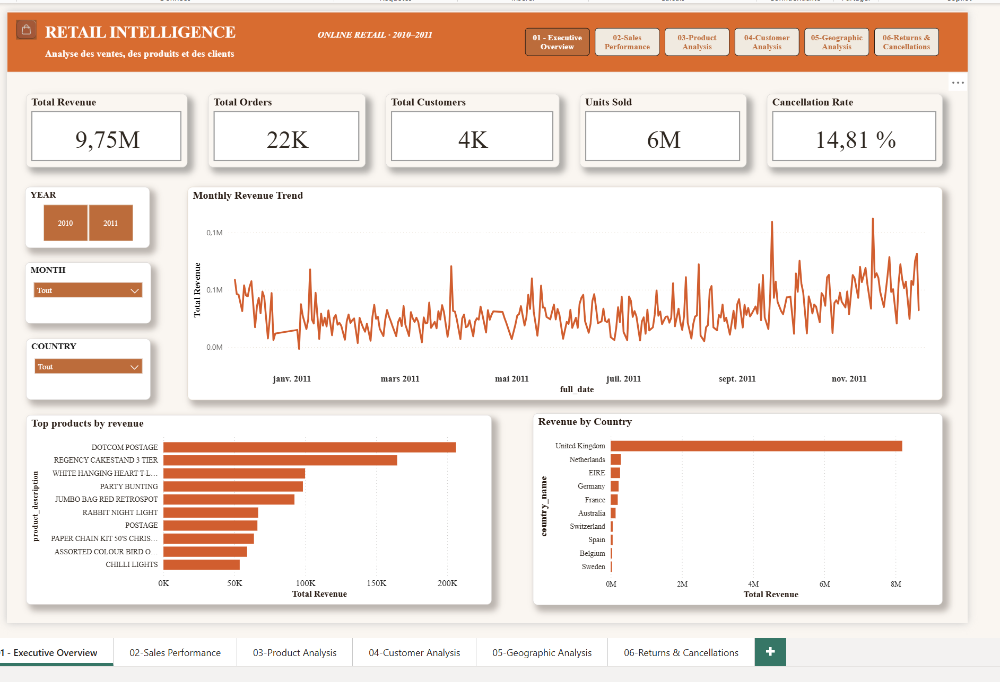
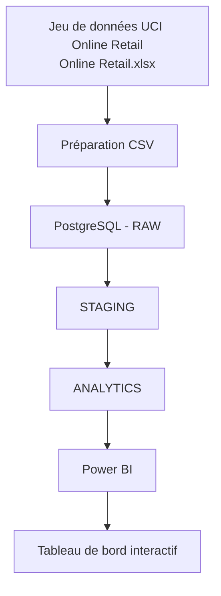

# Retail Intelligence

## Analyse des ventes, de la rentabilité et des clients

**Un projet de Business Intelligence consacré à l'exploration des transactions commerciales, des performances de vente, des produits, des clients et des tendances géographiques à l'aide de PostgreSQL, SQL, Power BI et DAX.**


---

## Sommaire

1. [Présentation du projet](#1-présentation-du-projet)
2. [Jeu de données](#2-jeu-de-données)
3. [Aperçu du tableau de bord](#3-aperçu-du-tableau-de-bord)
4. [Architecture technique](#4-architecture-technique)
5. [Structure du dépôt](#5-structure-du-dépôt)
6. [Installation et configuration](#6-installation-et-configuration)
7. [Organisation des scripts SQL](#7-organisation-des-scripts-sql)
8. [Gouvernance et documentation des données](#8-gouvernance-et-documentation-des-données)
9. [Data Profiling : principaux résultats](#9-data-profiling--principaux-résultats)
10. [Tableau de bord Power BI](#10-tableau-de-bord-power-bi)
11. [Principaux enseignements métier](#11-principaux-enseignements-métier)
12. [Limites du projet](#12-limites-du-projet)
13. [Livrables du projet](#13-livrables-du-projet)
14. [Auteur et technologies](#14-auteur-et-technologies)

---

## 1. Présentation du projet

**Retail Intelligence** est un projet de Business Intelligence réalisé à partir de données transactionnelles provenant d'une entreprise de commerce de détail en ligne.

L'objectif principal est d'explorer les transactions commerciales, d'évaluer la qualité des données, d'identifier les tendances métier et de transformer les données brutes en informations analytiques pertinentes grâce à un tableau de bord interactif développé avec Power BI.

Le projet suit un processus structuré de traitement des données, depuis leur ingestion dans la couche RAW jusqu'à la restitution des résultats analytiques.

### Objectifs du projet

- Explorer et analyser les données transactionnelles avec SQL.
- Stocker et gérer les données avec PostgreSQL.
- Réaliser des analyses de Data Profiling et de Data Quality.
- Identifier les valeurs manquantes, les doublons et les transactions inhabituelles.
- Préparer et transformer les données à des fins analytiques.
- Définir des règles métier et documenter les décisions de nettoyage.
- Organiser les données pour les analyses métier.
- Concevoir un tableau de bord interactif avec Power BI.
- Créer des mesures analytiques avec DAX.
- Documenter la traçabilité des données, leur qualité et la méthodologie du projet.

### Technologies utilisées

| Technologie | Utilisation |
|---|---|
| PostgreSQL 18 | Gestion de la base de données et stockage des données |
| SQL | Exploration, profilage, transformation et contrôles de qualité |
| Power BI | Développement du tableau de bord interactif |
| DAX | Création des indicateurs et calculs analytiques |
| Excel / CSV | Données sources et préparation des données |
| Markdown | Documentation technique et métier |

---

## 2. Jeu de données

### Source des données

Ce projet utilise le jeu de données **Online Retail**, disponible sur l'UCI Machine Learning Repository.

**Source officielle :** [UCI Machine Learning Repository – Online Retail Dataset](https://archive.ics.uci.edu/dataset/352/online+retail)

Le fichier original est nommé :

`Online Retail.xlsx`

Il contient des transactions réalisées par un détaillant en ligne britannique entre le **1er décembre 2010 et le 9 décembre 2011**.

### Télécharger le jeu de données

Le fichier Excel original n'est pas inclus dans ce dépôt GitHub. Il doit être téléchargé séparément depuis la source officielle de l'UCI.

Procédure :

1. Accéder à la [page du jeu de données Online Retail](https://archive.ics.uci.edu/dataset/352/online+retail).
2. Télécharger le jeu de données.
3. Extraire ou enregistrer le fichier nommé `Online Retail.xlsx`.
4. Placer le fichier dans le répertoire local suivant du projet :

```text
Retail_Intelligence/
└── data/
    └── raw/
        └── Online Retail.xlsx
```

**Important :** conserver le nom original du fichier et son emplacement afin de pouvoir suivre les instructions d'importation des données du projet.

### Description du jeu de données

Le jeu de données contient huit colonnes :

| Colonne | Description |
|---|---|
| `InvoiceNo` | Numéro de facture |
| `StockCode` | Code du produit |
| `Description` | Description du produit |
| `Quantity` | Quantité enregistrée dans la transaction |
| `InvoiceDate` | Date et heure de la transaction |
| `UnitPrice` | Prix unitaire |
| `CustomerID` | Identifiant du client |
| `Country` | Pays associé à la transaction |

### Caractéristiques du jeu de données

| Indicateur | Valeur |
|---|---:|
| Nombre total de lignes | 541 909 |
| Nombre de colonnes | 8 |
| Factures distinctes | 25 900 |
| Clients distincts non manquants | 4 372 |
| Codes produits distincts | 4 070 |
| Nombre de pays | 38 |
| Date de début | 1er décembre 2010 |
| Date de fin | 9 décembre 2011 |

### Périmètre des analyses métier

Ce jeu de données permet de réaliser plusieurs types d'analyses :

- Évolution des ventes et des montants transactionnels.
- Performance des produits.
- Activité des clients.
- Répartition géographique des transactions.
- Tendances mensuelles des ventes.
- Factures annulées.
- Mouvements transactionnels négatifs ou inhabituels.
- Qualité et cohérence des données.

**Limite métier :** le jeu de données contient les quantités vendues et les prix unitaires, mais ne fournit pas les coûts d'achat ou de production des produits. Le projet permet donc d'analyser les ventes et les montants transactionnels, mais ne permet pas de calculer les marges bénéficiaires ou la rentabilité réelle de l'activité.

---

## 3. Aperçu du tableau de bord

Le rapport Power BI comprend six pages analytiques conçues pour présenter différentes perspectives de l'activité commerciale.

### 3.1 Vue d'ensemble (Executive Overview)

Le tableau de bord principal présente une vue synthétique des principaux indicateurs de performance du commerce de détail.



### 3.2 Performance des ventes (Sales Performance)

Analyse de l'évolution des ventes et de l'activité commerciale au fil du temps.

### 3.3 Analyse des produits (Product Analysis)

Exploration des performances des produits et des tendances transactionnelles.

### 3.4 Analyse des clients (Customer Analysis)

Analyse de l'activité des clients et de leurs comportements d'achat.

### 3.5 Analyse géographique (Geographic Analysis)

Comparaison de l'activité commerciale entre les différents pays.

### 3.6 Annulations et mouvements négatifs (Cancellations & Negative Movements)

Étude des factures annulées et des transactions comportant des quantités ou des montants négatifs.

---

## 4. Architecture technique

Le projet repose sur une architecture de données en plusieurs couches permettant de séparer les données sources, leur préparation, les structures analytiques et la restitution des résultats.

### Flux des données



### Couches de données

| Couche | Responsabilité |
|---|---|
| RAW | Stocker les données sources importées tout en préservant leurs valeurs originales. |
| STAGING | Préparer, convertir et transformer les données pour leur utilisation ultérieure. |
| ANALYTICS | Organiser les données préparées pour les analyses métier. |
| Power BI | Construire les indicateurs analytiques et visualiser les résultats. |

La couche RAW constitue la référence des données sources importées. Les transformations sont organisées de manière à préserver la traçabilité des données et à faciliter les contrôles de qualité.

Pour plus d'informations :

- [Architecture technique](doc/architecture.md)
- [Traçabilité des données (Data Lineage)](governance/data_lineage/data_lineage.md)

---

## 5. Structure du dépôt

Le dépôt est organisé en répertoires dédiés aux données, aux scripts SQL, à la gouvernance, à Power BI et à la documentation du projet.

```text
Retail_Intelligence/
│
├── data/
│   └── raw/
│       └── Online Retail.xlsx       # Téléchargé séparément
│
├── sql/
│   ├── 01_database/
│   ├── 02_raw/
│   ├── 03_profiling/
│   ├── 04_staging/
│   ├── 05_analytics/
│   └── 06_quality_checks/
│
├── governance/
│   ├── business_rules/
│   │   └── business_rules_and_cleaning_decisions.md
│   │
│   ├── data_dictionary/
│   │   ├── data_dictionary.md
│   │   └── data_dictionary.xlsx
│   │
│   ├── data_lineage/
│   │   └── data_lineage.md
│   │
│   └── data_quality/
│       ├── profiling_report.md
│       ├── data_quality_framework.md
│       ├── Data_Quality_Report.md
│       └── staging_quality_report.md
│
├── powerbi/
│   ├── documentation/
│   │   └── report_documentation.md
│   │
│   └── reports/
│       ├── Retail_Intelligence.pbix
│       └── README.md
│
├── deliverables/
│   └── screenshots/
│       ├── 01_executive_overview.png
│       ├── 02_sales_performance.png
│       ├── 03_product_analysis.png
│       ├── 04_customer_analysis.png
│       ├── 05_geographic_analysis.png
│       └── 06_cancellations_negative_movements.png
│
├── docs/
│   ├── project_overview.md
│   ├── architecture.md
│   └── methodology.md
│
├── README.md
└── .gitignore
```

**Remarque :** le fichier `Online Retail.xlsx` est présenté pour indiquer son emplacement local attendu. Le jeu de données doit être téléchargé séparément et est exclu du suivi Git.

### Rôle des principaux répertoires

| Répertoire | Responsabilité |
|---|---|
| `data/raw/` | Stockage local du jeu de données source téléchargé. |
| `sql/` | Regroupement des scripts SQL par étape de traitement. |
| `governance/` | Règles métier, dictionnaire de données, traçabilité et documentation de la qualité. |
| `powerbi/` | Rapport Power BI et sa documentation. |
| `deliverables/` | Captures d'écran du tableau de bord et supports de présentation. |
| `doc/` | Présentation du projet, architecture et méthodologie. |

---

## 6. Installation et configuration

### Prérequis

Les outils suivants sont nécessaires :

- PostgreSQL 18.
- pgAdmin ou les outils en ligne de commande PostgreSQL (`psql`).
- Microsoft Power BI Desktop.
- Visual Studio Code ou un autre éditeur de code.
- Le jeu de données original `Online Retail.xlsx`.

### Étape 1 – Télécharger le jeu de données

Télécharger le jeu de données depuis :

[UCI – Online Retail Dataset](https://archive.ics.uci.edu/dataset/352/online+retail)

Placer le fichier téléchargé dans :

```text
data/raw/Online Retail.xlsx
```

### Étape 2 – Créer la base de données PostgreSQL

Ouvrir pgAdmin ou le terminal PostgreSQL.

Se connecter à une base de données existante, par exemple `postgres`, puis exécuter :

```sql
CREATE DATABASE retail_intelligence;
```

**Important :** la création de la base doit être effectuée depuis une autre base, telle que `postgres`. PostgreSQL ne permet pas de créer une base de données depuis la base que l'on est en train de créer.

### Étape 3 – Se connecter à la base du projet

Se connecter à la nouvelle base de données :

```text
retail_intelligence
```

### Étape 4 – Créer les schémas de la base de données

Exécuter les commandes suivantes :

```sql
CREATE SCHEMA raw;

CREATE SCHEMA staging;

CREATE SCHEMA analytics;
```

Ces schémas permettent de séparer les différentes couches de traitement des données.

### Étape 5 – Importer les données sources dans RAW

La table source utilisée dans le projet est :

```text
raw.online_retail_source
```

Les huit colonnes sources sont initialement stockées au format `TEXT` et autorisent les valeurs NULL. Cette approche permet de préserver les valeurs originales importées avant leur conversion et leur transformation.

Après l'importation, vérifier le nombre de lignes :

```sql
SELECT COUNT(*)
FROM raw.online_retail_source;
```

Résultat attendu :

```text
541909
```

Ce contrôle permet de confirmer que le volume de données importé correspond à celui du jeu de données original.

---

## 7. Organisation des scripts SQL

Le répertoire `sql/` contient les requêtes utilisées pour créer, explorer, transformer et contrôler les données dans PostgreSQL.

### 7.1 Configuration de la base de données – `01_database/`

**Objectif :** préparer l'environnement PostgreSQL.

Les scripts couvrent notamment les opérations suivantes :

- Création de la base `retail_intelligence`.
- Création des schémas `raw`, `staging` et `analytics`.
- Préparation de l'environnement de travail.

### 7.2 Gestion des données brutes – `02_raw/`

**Objectif :** créer et gérer la zone de stockage des données sources.

Les scripts permettent notamment de :

- Créer la table RAW.
- Préparer l'importation des données.
- Vérifier le nombre de lignes importées.
- Contrôler la structure des colonnes sources.
- Préserver les valeurs originales des données.

### 7.3 Data Profiling – `03_profiling/`

**Objectif :** explorer le jeu de données et évaluer sa qualité à l'aide de requêtes SQL.

Les scripts de profilage sont organisés comme suit :

| Script | Objectif |
|---|---|
| `01_row_count.sql` | Vérifier le volume des données. |
| `02_missing_values.sql` | Identifier les valeurs manquantes. |
| `03_cardinality.sql` | Calculer le nombre de valeurs distinctes. |
| `04_value_distribution.sql` | Examiner la distribution des valeurs. |
| `05_numeric_profiling.sql` | Analyser les variables numériques. |
| `06_date_profiling.sql` | Examiner les dates et les répartitions temporelles. |
| `07_duplicate_detection.sql` | Identifier les doublons exacts et partiels. |
| `08_invoice_analysis.sql` | Analyser les factures et leurs caractéristiques. |
| `09_profiling_summary.sql` | Consolider les résultats du Data Profiling. |

### 7.4 Préparation des données – `04_staging/`

**Objectif :** préparer et transformer les données pour leur exploitation analytique.

Cette couche comprend notamment les opérations suivantes :

- Conversion des colonnes sources vers des types de données adaptés.
- Harmonisation des formats.
- Gestion des valeurs manquantes selon les règles documentées.
- Identification des types de transactions spécifiques.
- Préparation des données pour les analyses métier.

Les transformations respectent les décisions documentées dans :

`governance/business_rules/business_rules_and_cleaning_decisions.md`

### 7.5 Couche analytique – `05_analytics/`

**Objectif :** organiser les données préparées pour les analyses métier.

Cette couche prend en charge les structures analytiques utilisées pour étudier :

- Les ventes.
- Les produits.
- Les clients.
- Les dates.
- Les pays.

Les structures analytiques facilitent le calcul des indicateurs et l'exploitation des données dans Power BI.

### 7.6 Contrôles de qualité des données – `06_quality_checks/`

**Objectif :** vérifier la qualité et la cohérence des données.

Les contrôles portent notamment sur :

- La complétude.
- L'unicité.
- La validité des valeurs.
- La cohérence des quantités et des montants transactionnels.
- L'intégrité référentielle.
- La cohérence des volumes de données entre les différentes couches.

Les résultats sont documentés dans les rapports de qualité correspondants.

---

## 8. Gouvernance et documentation des données

La gouvernance des données permet de documenter, de comprendre et de contrôler les informations utilisées tout au long du projet.

Le projet comprend les documents suivants :

| Document | Responsabilité |
|---|---|
| `business_rules_and_cleaning_decisions.md` | Définir les règles métier et justifier les décisions de nettoyage des données. |
| `data_dictionary.md` | Décrire les colonnes sources et leur signification métier. |
| `data_dictionary.xlsx` | Présenter le dictionnaire de données sous forme de tableau. |
| `data_lineage.md` | Décrire le parcours des données entre les différentes couches. |
| `profiling_report.md` | Présenter les résultats détaillés du Data Profiling. |
| `data_quality_framework.md` | Définir les dimensions de la qualité des données et les principes de contrôle. |
| `Data_Quality_Report.md` | Documenter les résultats des contrôles de qualité. |
| `staging_quality_report.md` | Documenter la qualité des données préparées dans la couche STAGING. |

### Approche de la qualité des données

Les valeurs inhabituelles ne sont pas automatiquement considérées comme des erreurs.

Par exemple, lorsqu'une transaction contient une quantité négative, l'investigation consiste à :

1. Identifier la transaction concernée à l'aide de SQL.
2. Examiner la facture et les attributs disponibles.
3. Vérifier si la transaction est annulée ou présente une autre caractéristique particulière.
4. Documenter les observations.
5. Appliquer un traitement uniquement après avoir compris le contexte métier.

**Principe essentiel :** la qualité des données ne consiste pas simplement à supprimer les valeurs inhabituelles. Elle consiste à comprendre leur origine et à préserver les informations pertinentes.

---

## 9. Data Profiling : principaux résultats

Le Data Profiling a été réalisé sur l'ensemble des **541 909 lignes sources**.

L'analyse a permis de mettre en évidence plusieurs caractéristiques importantes ainsi que des situations nécessitant une interprétation métier.

### 9.1 Valeurs manquantes

| Colonne | Valeurs manquantes | Pourcentage |
|---|---:|---:|
| `CustomerID` | 135 080 | 24,93 % |
| `Description` | 1 454 | 0,27 % |
| Autres colonnes | 0 | 0 % |

L'absence d'identifiant client concerne près d'un quart des lignes de transaction. Cela constitue une limite importante pour les analyses individuelles des clients.

### 9.2 Analyse des quantités et des prix unitaires

| Indicateur | Résultat |
|---|---:|
| Quantités négatives | 10 624 lignes |
| Quantités nulles | 0 ligne |
| Quantité minimale | -80 995 |
| Quantité maximale | 80 995 |
| Prix unitaires négatifs | 2 lignes |
| Prix unitaires nuls | 2 515 lignes |
| Prix unitaire minimal | -11 062,06 |
| Prix unitaire maximal | 38 970 |

Les valeurs négatives et nulles nécessitent des investigations complémentaires.

Elles peuvent correspondre à des annulations, des ajustements ou d'autres mouvements transactionnels spécifiques. Elles ne doivent pas être automatiquement considérées comme des erreurs ou des retours clients.

### 9.3 Analyse des factures

| Type de facture | Nombre de factures | Pourcentage |
|---|---:|---:|
| Factures normales | 22 064 | 85,19 % |
| Factures annulées | 3 836 | 14,81 % |
| Total | 25 900 | 100 % |

Les factures annulées sont identifiées par un numéro de facture commençant par la lettre `C`.

### 9.4 Détection des doublons

Le profilage a permis d'identifier :

- 4 879 groupes de doublons exacts.
- 10 147 lignes appartenant à des groupes de doublons exacts.
- 5 268 lignes supplémentaires au sein de ces groupes.
- 9 688 groupes de répétitions partielles.

Les répétitions partielles ne constituent pas nécessairement des erreurs. Plusieurs transactions peuvent concerner une même facture et un même produit.

Les différentes catégories de doublons peuvent se chevaucher. Elles ne doivent donc pas être additionnées sans tenir compte de leurs définitions respectives.

### 9.5 Répartition géographique

Les transactions sont fortement concentrées au Royaume-Uni.

| Pays | Nombre de lignes | Part des lignes |
|---|---:|---:|
| Royaume-Uni | 495 478 | 91,43 % |
| Allemagne | 9 495 | 1,75 % |
| France | 8 557 | 1,58 % |
| EIRE | 8 196 | 1,51 % |

Ces pourcentages représentent la part des lignes de transaction et non la part du chiffre d'affaires.

### 9.6 Analyse temporelle

- Période d'observation : du 1er décembre 2010 au 9 décembre 2011.
- Année 2010 : 42 481 lignes.
- Année 2011 : 499 428 lignes.
- Mois le plus représenté : novembre 2011, avec 84 711 lignes.
- Jour de la semaine le plus représenté : jeudi, avec 103 857 lignes.
- Aucune transaction n'a été enregistrée le samedi.

Le mois de décembre 2011 étant incomplet, les comparaisons mensuelles doivent tenir compte de cette particularité.

### 9.7 Investigation des quantités négatives

Les contrôles complémentaires de qualité ont permis d'identifier :

- 9 288 lignes à quantité négative associées à des factures annulées.
- 1 336 lignes à quantité négative associées à des factures normales.

Les 1 336 lignes à quantité négative associées à des factures normales présentent les caractéristiques suivantes :

- Prix unitaire nul.
- Montant de ligne nul.
- Identifiant client manquant.
- Pays associé : Royaume-Uni.

Ces caractéristiques suggèrent des mouvements de stock ou des ajustements spécifiques. Elles ne permettent pas de conclure avec certitude que toutes ces lignes correspondent à des retours clients.

Pour consulter les résultats détaillés :

`governance/data_quality/profiling_report.md`

---

## 10. Tableau de bord Power BI

Le rapport Power BI constitue la couche de restitution visuelle du projet.

Il comprend six pages analytiques :

| Page | Objectif |
|---|---|
| Executive Overview | Présenter les principaux indicateurs de performance. |
| Sales Performance | Analyser l'activité commerciale et l'évolution des ventes. |
| Product Analysis | Explorer les performances des produits. |
| Customer Analysis | Analyser l'activité des clients. |
| Geographic Analysis | Comparer l'activité commerciale entre les pays. |
| Cancellations & Negative Movements | Examiner les annulations et les mouvements transactionnels négatifs. |

### Navigation et filtres

Le rapport comprend :

- Un navigateur de pages.
- Un filtre YEAR (année).
- Un filtre MONTH (mois).
- Un filtre COUNTRY (pays).
- Des filtres synchronisés sur les six pages.

### Identité visuelle

Le tableau de bord utilise une palette graphique cohérente :

| Élément | Couleur |
|---|---|
| Couleur principale | `#C9662D` |
| Fond beige | `#F2EADF` |
| Texte principal | `#30271F` |
| Texte secondaire | `#71675E` |
| Bordures | `#E5D8C9` |
| Cartes | Blanc |

Le rapport utilise la police Segoe UI.

### Accéder au rapport Power BI

Le fichier Power BI principal se trouve dans :

`powerbi/reports/Retail_Intelligence.pbix`

Documentation du tableau de bord :

`powerbi/documentation/report_documentation.md`

Captures d'écran du tableau de bord :

`deliverables/screenshots/`

Informations complémentaires sur le répertoire des rapports Power BI :

`powerbi/reports/README.md`

---

## 11. Principaux enseignements métier

Les analyses de profilage et le tableau de bord mettent en évidence plusieurs caractéristiques importantes du jeu de données commercial.

**Concentration géographique :** le Royaume-Uni représente 91,43 % des lignes de transaction, ce qui révèle une forte concentration de l'activité enregistrée sur ce marché.

**Identification des clients :** 24,93 % des lignes ne possèdent pas d'identifiant client, ce qui limite l'exhaustivité des analyses au niveau individuel.

**Annulations de factures :** 3 836 factures, soit 14,81 % des factures distinctes, sont identifiées comme annulées.

**Mouvements transactionnels inhabituels :** les quantités négatives, les prix nuls et certains enregistrements d'ajustement nécessitent une interprétation contextuelle plutôt qu'une suppression automatique.

**Concentration temporelle :** novembre 2011 est le mois le plus représenté dans le jeu de données, avec 84 711 lignes de transaction.

Ces observations permettent de mieux interpréter les résultats du tableau de bord et de comprendre les limites des données sources.

---

## 12. Limites du projet

Plusieurs caractéristiques du jeu de données doivent être prises en compte lors de l'interprétation des résultats :

- Une proportion importante des transactions ne possède pas d'identifiant client.
- L'activité transactionnelle est fortement concentrée au Royaume-Uni.
- Certaines factures sont annulées.
- Certaines quantités et certains prix unitaires sont nuls ou négatifs.
- Les lignes répétées ne constituent pas nécessairement des erreurs de données.
- La période d'observation couvre environ une année.
- Le mois de décembre 2011 est incomplet.
- Les coûts d'achat ou de production des produits ne sont pas disponibles.

Par conséquent, le projet se concentre sur l'activité commerciale, les montants transactionnels ainsi que les analyses des clients, des produits et des performances géographiques. Il ne prétend pas calculer la rentabilité réelle de l'activité ni les marges bénéficiaires.

---

## 13. Livrables du projet

Le projet rassemble les livrables suivants :

- Une base de données PostgreSQL contenant les données sources.
- Des scripts SQL organisés par étape de traitement.
- Des analyses de Data Profiling.
- Des investigations complémentaires sur la qualité des données.
- Des scripts de préparation et de transformation des données.
- Des règles métier et des décisions de nettoyage documentées.
- Un dictionnaire de données et une documentation de traçabilité.
- Des rapports sur la qualité des données.
- Un tableau de bord Power BI interactif composé de six pages analytiques.
- Des captures d'écran du tableau de bord et une documentation technique.

Le dépôt a pour objectif de rendre la structure du projet, sa méthodologie et ses résultats analytiques compréhensibles et reproductibles.

---

## 14. Auteur et technologies

**Projet :** Retail Intelligence – Analyse des ventes, de la rentabilité et des clients

**Domaine :** Analyse de données et Business Intelligence

**Technologies :** PostgreSQL, SQL, Power BI, DAX, Excel et Markdown.

**Source des données :** [UCI Machine Learning Repository – Online Retail](https://archive.ics.uci.edu/dataset/352/online+retail)

